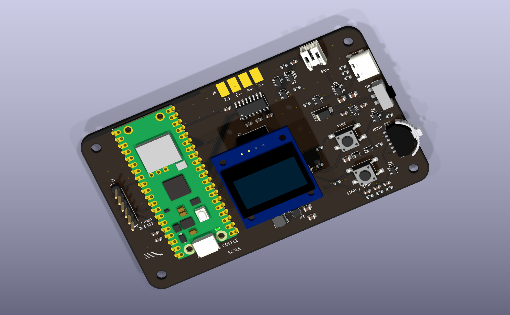

# Coffee Scale Controller

Open-hardware electronics for a coffee scale controller. The project contains
the KiCad design, revision history, manufacturing records, release tooling, and
a browser-based review portal.



*Revision E routed prototype, shown as a faithful KiCad-derived isometric render.
The image is for design review; the hardware is not yet production-approved.*

## Current status

- **Hardware:** Revision E routed prototype.
- **Not complete:** Firmware, physical validation, supplier approval, and final
  assembly decisions.
- **Authoritative design:** `src/`.
- **Historical records:** `src/fabrication/` and revision snapshots under `src/`.

This repository is public and intended for open-hardware development. A
maintainer still needs to choose and add the project's hardware, software, and
documentation licenses; no legal license was guessed.

## Repository map

| Path | Purpose |
| --- | --- |
| `src/` | KiCad sources, local libraries, models, revision snapshots, and historical fabrication data |
| `assembly/` | Assembly profile used by the release workflow |
| `scripts/legacy/` | Historical placement, routing, revision, and packaging utilities |
| `tools/` | Maintained release and portal build tooling |
| `docs/` | Detailed board, manufacturing, and compatibility documentation |
| `tests/` | Release and viewer regression checks |
| `web/` | Browser review portal source and pinned vendor assets |
| `build/`, `tmp/`, `work/`, `outputs/` | Generated or intermediate files; not committed |

## Quick start

Requirements (Windows, macOS or Linux):

- KiCad 10, which provides `kicad-cli`
- Node.js 22 or newer — no `npm install` needed; the tooling has no dependencies

From the repository root:

```sh
node release.mjs --validate-only   # ERC, DRC, schematic parity and dimensions
node release.mjs                   # full prototype release build
node preview.mjs                   # serve the newest build on http://127.0.0.1:8787
```

The same commands are available as `npm run validate`, `npm run release` and
`npm run preview`. `node release.mjs --require-assembly-ready` additionally
fails the build while assembly blockers remain.

`kicad-cli` is found from `--kicad-cli <path>`, then the `KICAD_CLI`
environment variable, then `PATH`, then the standard install location
(`C:/Program Files/KiCad/10.0/bin` on Windows,
`/Applications/KiCad/KiCad.app/Contents/MacOS` on macOS, `/usr/bin` on Linux).
Each build creates a new timestamped folder under `build/releases/`.

## Release contents

Each successful build contains:

- `source/` — isolated KiCad design snapshot
- `reports/` — ERC, DRC, netlist, statistics, and build log
- `fabrication/` — Gerbers, drills, and manufacturing notes
- `assembly/` — BOM, placement data, IPC-2581, stencil layers, and readiness
- `mechanical/` — STEP/DXF exports and interface data
- `site/` — review portal and downloadable packages
- `manifest.json` — hashes, tool versions, status, and readiness

The assembly profile in `assembly/profile.csv` is intentionally retained: the
release workflow reads it to apply population stages, sourcing metadata,
rotation corrections, and verification state. It is not proof of supplier
approval.

## Checks

```sh
npm test        # or: node --test tests/*.test.mjs
```

GitHub Actions runs these tests on Windows, macOS and Linux, then runs the
validation and a full release build inside the official, version-pinned
`kicad/kicad` container. The build is attached to each run as an artifact.

Each push to `main` also publishes that build's review portal to GitHub Pages
at <https://jpnbino.github.io/coffee-scale/>. The page is public and shows a
prototype design; it is not production or supplier approval.

See `docs/board/` for the detailed circuit, assembly, mechanical, viewer, and
manufacturing notes. Legacy utilities should be run from the repository root;
they write candidates and intermediate files to their existing revision and
`tmp/` locations.
