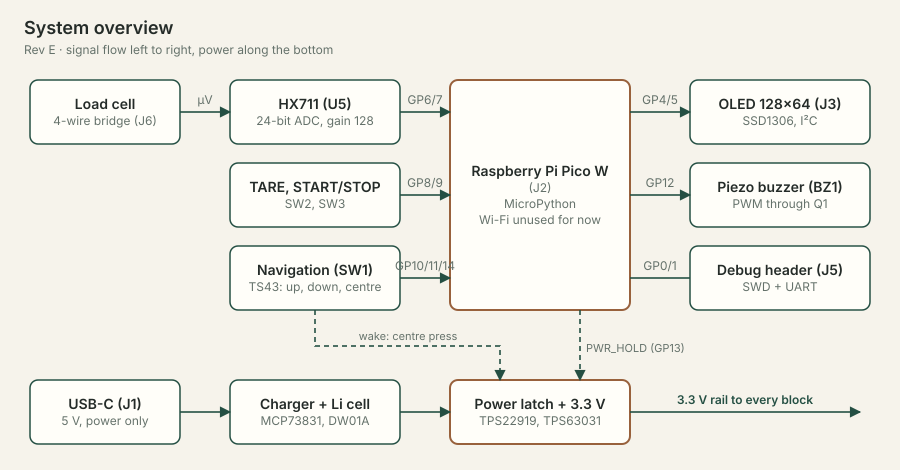

# Overview

What the board is, where it stands, and where to start reading for what you want to do.

The Coffee Scale controller is an open-hardware board for a brewing scale. A
four-wire load cell feeds an HX711 bridge ADC; a Raspberry Pi Pico W shows
weight, flow and brew time on an SSD1306 OLED; a single lithium cell, charged
from USB-C, makes it portable. Wi-Fi is available for later experiments such as
recording brewing sessions.

The diagrams in these pages are drawn by hand to explain the design; the KiCad
schematic is authoritative. Each part and net named in the text links to the
[interactive design viewer](https://jpnbino.github.io/coffee-scale/explore.html), where you can follow it on the schematic and
the PCB at the same time.

## Where it stands

- **Hardware:** Revision E is a routed, electrically checked design. It has not
  been built or bench-tested, and it is not production-qualified.
- **Firmware:** prototype firmware runs on a breadboard build and has been used to
  brew coffee. It lives in
  [coffee-scale-firmware](https://github.com/jpnbino/coffee-scale-firmware) and
  is not yet ported to this board.
- **Not yet done:** physical testing of Rev E, supplier-approved parts, battery
  approval, the enclosure, and a licence.

The board is 100 × 60 mm, two copper layers, 1.6 mm thick, with rounded corners
and four 3.2 mm mounting holes. The Pico and debug header are on the left, the
load-cell pads at the top, and charging, power and navigation on the right.

## Start here

| If you want to… | Read |
| --- | --- |
| Understand how it works | [Circuit and power](02-circuit.md), then the [interactive design viewer](https://jpnbino.github.io/coffee-scale/explore.html) |
| Build one | [Assembly and testing](04-assembly-testing.md), [Interfaces and firmware contract](03-interfaces.md) |
| Write or port firmware | [Interfaces and firmware contract](03-interfaces.md) |
| Design a case | [Mechanics, revisions and open work](05-mechanics-notes.md) |
| Order boards or review manufacturing data | [Stackup and manufacturing control](07-manufacturing-control.md), [Revision review and Gerber inspection](06-revision-review.md) |

## How this documentation stays trustworthy

- **One source of truth.** The KiCad files define the circuit and geometry.
  Component fields and the assembly profile define what to buy and fit. These
  pages explain decisions and limits. Generated files are never edited by hand.
- **Every release is rebuilt and checked.** Each push to the repository runs the
  electrical checks, rebuilds every drawing, model and manufacturing file, and
  records checksums of the sources and outputs.
- **Nothing is claimed that was not checked.** A clean ERC/DRC shows the design is
  consistent; it does not show the board works. Physical tests and supplier
  approval are tracked separately and marked as open until done.
