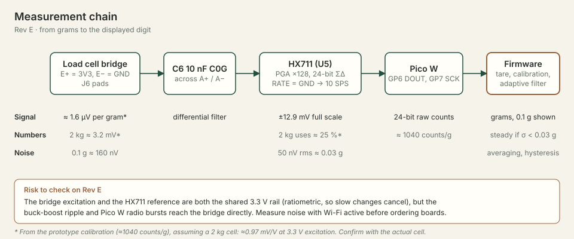
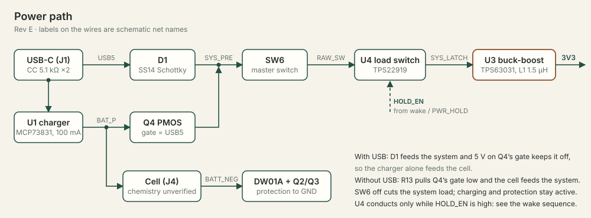
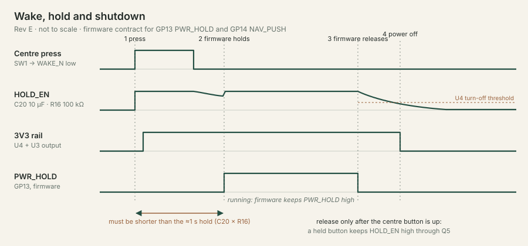

# Circuit and power

How the board measures weight, powers itself from USB-C or a single lithium cell, and wakes and sleeps.

## Controller and measurements

The Pico W connects to an I²C OLED and an [HX711](https://jpnbino.github.io/coffee-scale/explore.html?part=U5) with four solder pads for a
four-wire load cell. The intended cell capacity is 2 kg. Wire colours must be
identified from the actual load cell; they are not a universal pinout.

The bridge signal is tiny: about 1.6 µV per gram if the prototype calibration
holds for this cell, so a tenth of a gram is roughly 160 nV. The HX711 sees it on
[CELL_A_P](https://jpnbino.github.io/coffee-scale/explore.html?net=CELL_A_P) and [CELL_A_N](https://jpnbino.github.io/coffee-scale/explore.html?net=CELL_A_N), after the 10 nF C0G capacitor [C6](https://jpnbino.github.io/coffee-scale/explore.html?part=C6). Its
RATE pin is tied to ground, fixing the output at 10 samples per second, and the
Pico reads it over [HX_DOUT](https://jpnbino.github.io/coffee-scale/explore.html?net=HX_DOUT) and [HX_SCK](https://jpnbino.github.io/coffee-scale/explore.html?net=HX_SCK). Both the bridge excitation
and the ADC reference come from the shared 3.3 V rail; whether buck-boost ripple
and Wi-Fi bursts stay below the noise floor is the first thing to measure on a
built board.

The carrier supplies regulated 3.3 V to Pico pin 36. Pin 37, 3V3_EN, is grounded
to disable the Pico's onboard regulator. VSYS and VBUS are unused. **Do not
connect the Pico USB port while using this external-power arrangement.**

## Battery and charging

USB-C is charging/power only, with separate CC pull-downs. An [MCP73831](https://jpnbino.github.io/coffee-scale/explore.html?part=U1) charges
a single 4.2 V lithium cell, provisionally at 100 mA with a 10 kΩ PROG resistor.
A load-sharing pair, Schottky [D1](https://jpnbino.github.io/coffee-scale/explore.html?part=D1) and PMOS [Q4](https://jpnbino.github.io/coffee-scale/explore.html?part=Q4), lets the board run while charging: with USB present D1 feeds [SYS_PRE](https://jpnbino.github.io/coffee-scale/explore.html?net=SYS_PRE) and Q4 is held off; without USB, Q4 connects the cell.
DW01A protection and opposing MOSFETs separate raw cell negative, BATT_NEG,
from protected circuit ground. Do not bypass that protection by shorting them.

LP503040 describes the intended cell size, not a complete approved battery
specification. Cell chemistry, ratings, temperature limits and JST polarity
remain to be verified. There is no battery thermistor circuit.

## Controls and shutdown

Two top buttons provide TARE and START/STOP. The Same Sky TS43 switch provides
momentary up/down and centre press; it is not a quadrature encoder.
Centre press starts the hardware wake circuit ([Q5](https://jpnbino.github.io/coffee-scale/explore.html?part=Q5), D3) by charging [HOLD_EN](https://jpnbino.github.io/coffee-scale/explore.html?net=HOLD_EN), which turns on the [TPS22919](https://jpnbino.github.io/coffee-scale/explore.html?part=U4) load switch. Q6 passes the press
to GP14 as an isolated, active-high signal, kept away from the raw switch and
battery voltage. [C20](https://jpnbino.github.io/coffee-scale/explore.html?part=C20) holds the supply on for a nominal ~1 s; check the usable
start-up time on the bench. Firmware must assert [PWR_HOLD](https://jpnbino.github.io/coffee-scale/explore.html?net=PWR_HOLD) within that time,
before Wi-Fi initialization, and wait for centre release before shutdown. The intended inactivity timer is one hour; firmware is not included.

The master switch disconnects the system load. Charging and battery protection
remain active. The piezo buzzer is bottom-mounted and requires external PWM
drive, nominally around 4 kHz.
